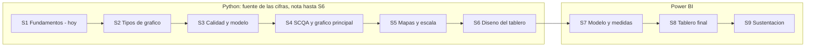

# 📋 Clase 1 — Fundamentos: figuras feas, malas y erróneas (07 de noviembre de 2026)

> Primera sesión de **Visualización de Datos y Gerencia de la Información** (Esp. en Analítica de Datos, UNAULA), por Teams (~2 h 45 min grabados). Primera parte: teoría con el caso del profe (*Golden State*). Segunda parte, después del descanso: taller en Python con el caso de los estudiantes (*CONECTA*).
>
> **Fuentes:** *(clase)* = lo dicho en la grabación · *(presentación)* = `presentacion_sesion_01.pdf` · *(notebook)* = `sesion_01_practica_proyecto_A.ipynb` · *(datos)* = comprobado en el CSV, no dicho en clase. Lo dudoso va marcado con ❓.

---

## 🧭 Lo esencial de esta clase
- El curso **no enseña a hacer más gráficas**: enseña a **transmitir una historia (storytelling)** con gráficas y tableros para quien tiene que decidir.
- Una figura puede fallar de tres formas: **fea** (estética), **mala** (induce una lectura equivocada) o **errónea** (lo que se ve no corresponde a los datos). La errónea es la que engaña.
- Antes de graficar: **¿quién decide qué?** → la *ficha del comité* (destinatario, decisión, restricción, por qué importa, pregunta).
- Conceptos del día: **datos y estéticas**, **escalas** (lineal vs. logarítmica) y **coordenadas** (plano cartesiano vs. proyección).
- **IA sí, pero entendiendo lo que produce**, y el **tablero final se construye en una herramienta de visualización**.
- **Entrega del taller S1: viernes 13 de noviembre, 5 pm**, en grupo de máximo 3 (ver la última sección).

---

## 1. El curso y sus reglas

**Profe** *(clase)*: se presentó como Edgar García ❓ (nombre tal como lo transcribió Teams); ingeniero electrónico con dos maestrías, ~6 años en Tigo y hoy en Nequi, en analítica de datos orientada a servicio. Es el último curso de la especialización, así que es una **recopilación** de lo ya visto, **desde la visualización**: cómo ofrecer algo que sirva y tenga valor para quien lo pide. Los perfiles del grupo son muy variados y lo ve como ventaja.

### Las 9 sesiones *(presentación, diap. 3 y 4)*
| Sesión | Tema | Bloque |
|---|---|---|
| S1 | Fundamentos (feo / malo / erróneo) | Python: entender y preparar |
| S2 | Tipos de gráfico | Python |
| S3 | Calidad y modelo (limpieza) | Python |
| S4 | SCQA y gráfico principal | Python: decidir |
| S5 | Mapas y escala | Python: ubicar y comunicar |
| S6 | Diseño del tablero | Python |
| S7 | Power BI: modelo y medidas | Power BI |
| S8 | Power BI: tablero final | Power BI |
| S9 | Sustentación final | Power BI |

- **S1–S6:** se hila, sesión a sesión, la historia de un problema de negocio; Python es la fuente de las cifras. **S7–S9:** el trabajo pasa a la herramienta de tableros (hay licencia de Power BI con el correo estudiantil) y se verifica contra lo hecho en Python.
- ❓ En clase el profe también habló de "las primeras 8 sesiones" y "la última para sustentar"; la presentación respalda la versión **6 + 3**.
- **Cada sesión:** ~2 h de teoría + ~2 h de taller en notebook, y **quiz al inicio de la sesión siguiente** (el de S1, al inicio de S2) *(presentación, diap. 4 y 45; no se dijo en voz alta)*.
- **Dos casos, las mismas tareas:** el profe resuelve con *Golden State Realty Advisors*; cada equipo resuelve lo mismo con **CONECTA S.A.**, en uno de cuatro proyectos (Retención, Calidad del servicio, Ingreso, Expansión) que mantiene hasta S9. Aquí: **Proyecto A, Retención** *(presentación)*.
- **Bibliografía:** Wilke (2019), *Fundamentals of Data Visualization*; Knaflic (2015), *Storytelling with Data*.

### Evaluación *(clase)*
- Un taller por clase **hasta la S6**; el profe pasa las notas con lo hecho hasta ahí (la coordinación le fijó una fecha límite). Lo de Power BI es para dominar la herramienta.
- **7 entregables:** 6 talleres (S1–S6) + el tablero de Power BI sustentado al final *(clase + `IMPORTANTE.txt`)*. ❓ No quedó claro cómo pesa el tablero si la nota se cierra en S6.
- Los talleres se piensan para hacerse **en clase** (≤ ~2 h), sin llevar trabajo a casa; si 3 h no alcanzan, el profe recortaría el taller.
- La entrega puede llegar **hasta antes de la siguiente clase**, pero hay que ir al día: entregar la S1 hacia el 20 de noviembre generaría reprocesos. Con viaje o turnos de trabajo, **escribirle al profe con tiempo**.
- **Grupos de máximo 3** (recomienda al menos 2 para repartir carga; individual es posible). Se numeran en el chat de Teams (Grupo 1, 2, …); un compañero contó más de 15 grupos.

### ⚠️ Reglas sobre IA y tableros
- **La IA no está prohibida:** es apoyo para decidir mejor. Lo que importa es **entender y poder explicar** lo que produjo (el problema hoy no es resolver, sino entender la solución; no basta copiar y pegar). Uno la guía y revisa que no haga algo distinto a lo pedido o más complejo de lo necesario. **Cada entrega declara para qué se usó la IA** *(presentación, diap. 4; notebook)*.
- **El tablero se construye en una herramienta de visualización:** Power BI, Data Studio u otra que el estudiante conozca (el profe nombró una segunda que la transcripción no deja clara ❓). **No se acepta** un tablero de fórmulas en Excel ni una página HTML armada con IA: el profe contó que en el curso anterior le entregaron eso.

---

## 2. Caso del profe: *Golden State Realty Advisors* (vivienda en California)
- **Situación** *(clase + presentación, diap. 6 y 33)*: asesora de un fondo de inversionistas en vivienda. El **comité de inversión** decide cada trimestre en qué distritos hace la **debida diligencia**. Capacidad: **150 distritos por trimestre** (supuesto del caso) de **20 640** → se revisa **menos del 1 %**, así que hay que **ordenar y elegir**, no solo describir.
- **Datos:** base pública de Kaggle, censo de **1990** (no actualizada; se discute en S8). Cada fila es un distrito con la **mediana** del valor de la casa y del ingreso, y la zona (cerca de la bahía, del océano, a <1 h del mar, interior, isla). Analogía del profe: "como si fuera Antioquia, con municipios y barrios".
- **¿Por qué la mediana?** Es el valor del 50 % y se deja influir menos por los atípicos.
- **Pregunta:** *¿dónde la vivienda se vende por debajo de lo que el ingreso de sus residentes sostiene?* (hay relación creciente ingreso–valor). La presentación aclara que es una **premisa** del fondo (que la brecha se cierre) y que valor (patrimonio) e ingreso (flujo) no se comparan directo: se dividen → "años de ingreso que cuesta la vivienda".
- **Qué pasó:** el analista anterior entregó un informe de 4 gráficos que **hizo ver la vivienda cerca de la bahía ~6 veces más cara que la del interior**, y el comité concentró allí su atención.

### Los 4 gráficos del informe y su diagnóstico *(clase + presentación, diap. 11–22)*
| # | Gráfico | Tipo | Qué falla | Corrección |
|---|---|---|---|---|
| 1 | Distribución del valor (histograma) | **Fea** | Colores chillones, cuadrícula negra, tres tipos de letra; eje "Frecuencia" sin decir qué cuenta | Título y unidades claras (miles de USD, distritos), franja del 50 % central y el **dato truncado en USD 500 000 a la vista**: hay que poder explicarlo (en S3 se comprueba si es precio real o tope del registro) |
| 2 | Valor e ingreso por zona | **Malo** | **Doble eje** con escalas distintas (0–250 000 y ~32 000–42 000 *(clase)*): la relación aparece porque así se eligieron las escalas; sin leyenda | **Un panel por variable**, cada uno desde cero (separar no cuesta nada) |
| 3 | Valor por zona (barras) | **Errónea** | Eje que **empieza en USD 100 000** y sin escala: la bahía "parece valer 6 veces" el interior; en realidad ≈ **2,1 veces**. El recorte le quita al interior ~80 % de su barra y a la bahía ~39 % | Eje **desde cero**, con valores y título con la conclusión |
| 4 | Distritos por zona (torta) | **Discutible** | El ojo compara mal áreas y arcos; la categoría "isla" casi no se ve (además traía sombra) | Barras |

- **Definiciones** (Wilke 2019, pp. 2–3): **fea** = lo estético, funciona pero incomoda; **mala** = la percepción, induce una lectura equivocada; **errónea** = los datos, lo que se ve no corresponde a los valores. Una visualización debe ser **precisa y no distorsionar**.
- **Gráficos que conviene evitar** *(presentación)*: Knaflic recomienda evitar torta, dona, 3D y eje secundario; **Wilke matiza** que la torta sirve para fracciones simples (mitad/mitad, "3/4 de la Tierra es agua"). De los 4 gráficos, **3 caen en esa lista**.
- **Qué conclusiones inducía el informe** *(presentación, diap. 8)*: "hay un bloque grande de casas de USD 500 000 = mercado caro importante"; "el valor sigue al ingreso, no hay más que buscar"; "la bahía vale seis veces el interior, concentremos allí la atención"; "el estado es casi todo interior y costa cercana". En conjunto, **mostraba datos pero no respondía a ninguna decisión**. Cada punto se comprueba en S1–S5 con indicadores, tasas en vez de conteos y comparables.
- **Pregunta del descanso (leyenda engañosa)** *(clase)*: una barra decía "incluye 965 distritos" pero parecía pasar de 1 000. La barra comienza en ~USD 483 000 y suma **~1 069**; **965** son los mayores a 500 000 (~100 son menores). Una leyenda ambigua parece incoherencia: hay que redactarla con precisión.

---

## 3. Datos y estéticas, escalas y coordenadas
**Estéticas** *(Wilke, pp. 7–9)*: toda visualización convierte valores en **posición, forma, tamaño, color, grosor y tipo de línea**. El tipo de variable decide la estética: las cualitativas sin orden (la zona) van en **color o forma, no en tamaño**; la posición es la más precisa. Ejemplo de clase: dispersión ingreso vs. valor con **color = zona** y **tamaño = otra variable**.

**Escalas** *(Wilke, pp. 10 y 16–21)*: la lineal (cada cuadro vale lo mismo) *sufre* con variables muy sesgadas, como **habitantes por distrito** (mediana 1 166, máximo 35 682) o **salarios**: casi todo cae en la primera barra. La **logarítmica** (distancias iguales = proporciones iguales) muestra la forma completa y permite ubicar dónde queda el 50 %. Hay que **rotularla y decirlo**: una audiencia no técnica no la espera.

**Coordenadas** *(Wilke, pp. 13–24)*: latitud y longitud ubican puntos sobre una esfera; graficarlas como plano cartesiano **deforma el mapa** (círculos de 100 km salen ovalados). Para solo ubicar puntos sirve; **para comparar áreas o distancias hay que usar una proyección** (cada una conserva áreas o ángulos, no ambos).

**Errores comunes** *(presentación, diap. 36)*: confundir feo con erróneo; elegir las escalas del doble eje para contar una historia; usar tamaño para una variable sin orden; graficar latitud/longitud como plano; **graficar antes de saber quién decide qué**.

---

## 4. Contexto: ¿quién decide qué? — la ficha del comité
Antes de preparar algo: ¿**para quién** es (técnico o no), qué necesita **saber o hacer**, quiere **informarse o decidir**? (Knaflic, pp. 20–26). Claves: un destinatario concreto (no "la gerencia") y una acción (no "informar"). Meta: un informe **autoexplicativo** que permita decidir con datos y no con gráficos sesgados.

| Elemento | *Golden State* |
|---|---|
| Destinatario | Comité de inversión (perfil financiero, no técnico: no enredarlo con gráficos que no entienda) |
| Decisión | En qué distritos hace la debida diligencia del trimestre |
| Restricción | 150 distritos por trimestre |
| Por qué importa | De 20 640 distritos se puede revisar menos del 1 %: hay que priorizar con métricas, no al azar |
| Pregunta | ¿Dónde la vivienda se vende por debajo de lo que sostiene el ingreso de sus residentes? |

---

## 💻 Taller — CONECTA, Proyecto A (Retención)

**Problema** *(presentación, diap. 37)*: CONECTA S.A. es un operador de telecomunicaciones de Bogotá con **Hogar** (internet fijo) y **Móvil** (pospago y prepago); datos sintéticos. La **Gerencia de Retención** lleva al **comité directivo de diciembre** una propuesta de campaña contra las cancelaciones para el **primer trimestre de 2027**: **en qué zonas concentrarla y cuánto invertir**. El informe del trimestre pasado tenía 4 gráficos y el comité no supo qué hacer con él. **Hoy no se calcula el indicador (S2) ni se limpian los datos (S3):** solo se diagnostica y se conoce la base.

**Datos** `datos/conecta_clientes_mes.csv`:
- **354 693 filas × 19 columnas** *(datos)*; **cada fila = un cliente en un mes**, así que contar filas ≠ contar clientes. **12 meses, nov. 2025 – oct. 2026** *(diccionario; en clase el profe dijo "octubre 2025" ❓ lapsus)*. ~30 000 clientes activos al mes (30 000 en nov. 2025, 28 886 en oct. 2026) y **36 601 clientes distintos** en total *(datos)*, porque entran y salen.
- **Territorio de Bogotá:** `codigo_upz` (es un **código**: no se suma ni promedia), `upz`, `localidad`, `estrato`, `latitud`, `longitud`. Hay 112 UPZ en 19 localidades; los clientes están en 102 UPZ *(presentación; datos)*.
- **Servicio:** `linea`, `modalidad` (pospago/prepago; Hogar siempre pospago), `plan` (Básico/Estándar/Plus; cambia de sentido según el segmento: velocidad en Hogar, datos incluidos en móvil pospago, paquete de recarga en prepago), `fecha_alta`, `antiguedad_meses`, `ingreso_mensual_cop` (**lo que el cliente paga a CONECTA**, no su ingreso; en prepago, la recarga del mes).
- **Comportamiento y resultado:** `uso_datos_gb`, `quejas_mes`, `nps`, `cancelo` (0/1: el sistema **registró** una cancelación ese mes) y `tipo_cancelacion` (vacío si no hubo).
- **`nps`** es la **respuesta individual de 0 a 10** a "¿qué tan probable es que recomiende CONECTA?" *(diccionario; en clase el profe dijo "entre 1 y 10")*. Lectura habitual: 9–10 promotor, 7–8 neutro, menos de 7 detractor *(clase)*. Falta en **~78,5 % de las filas** *(datos)*.

**Discusión sobre los NaN del NPS** *(clase)*:
- Es un problema real: la encuesta no le llega a todos; los incentivos para responder sirven a futuro, no con un histórico cerrado.
- **Imputar** (media, mediana…) es *inventar* calificaciones: con pocas encuestas se fabricaría casi toda la columna. Tampoco conviene un `dropna` que borre la base.
- **Alternativa:** analizar **por zona**: NPS, quejas y motivo de cancelación (idea de un compañero: revisar PQR y fallas masivas recurrentes). No se inventan datos: se da una justificación a nivel de zona. Un mapa de NPS por zona puede relacionarse con la cancelación (¿competencia con planes más baratos? ¿precio?), y el porqué se mira en `tipo_cancelacion`.

**Tareas del notebook** *(citan diap. 8, 11–20, 25 y 32–33)*:
1. **Ficha del proyecto:** destinatario, decisión, restricción (si la hay) y pregunta.
2. **Diagnosticar los 4 gráficos** (*Clientes activos*, *Clientes y cancelación*, *Cancelación por localidad*, *Clientes por plan*): feo/malo/erróneo y por qué.
3. **Diccionario, tipos de datos y estéticas:** tabla `tipos` con tipo de variable (Wilke, p. 9) y estética apropiada según **lo que representa** la columna, no lo que pandas asigne (ej. `codigo_upz` es un código).
4. **Rehacer los gráficos defectuosos:** el erróneo (barras desde cero, ordenadas, con valores y título-conclusión que compare **Kennedy con Chapinero** con eje en cero vs. eje en 2,5 %) y el malo (un panel por variable, desde cero).
5. **Qué debió concluir el comité** y qué revisar antes de confiar en los datos.
- **Preguntas de interpretación** (preparan S2): ¿por qué comparar conteos de cancelaciones no basta? (tasas); ¿se confía igual en la tasa de **La Candelaria** que en la de Kennedy? (tamaño de muestra); ¿por qué la localidad puede no ser la mejor escala? **Interpretación final** en 5–8 viñetas, que incluye **declarar para qué se usó IA**.
- El profe aclaró que las celdas "sin modificar" solo se ejecutan, que las preguntas de código casi son reusar el notebook guiado, y que el resto son preguntas abiertas.
- **Dos notebooks:** `sesion_01_guiada.ipynb` (la clase, con *Golden State* y `housing.csv`) y `sesion_01_practica_proyecto_A.ipynb` (el taller, con `conecta_clientes_mes.csv` y `upz.geojson`). Descomprimir `datos/` junto al notebook; si falla, puede faltar `geopandas`.

### 🔎 Pistas en los datos *(comprobado en el CSV; no se dijo en clase)*
- `localidad` trae **38 escrituras** para 19 localidades oficiales (mayúsculas y espacios, p. ej. `'Suba '` frente a `'SUBA'`) y `plan` trae variantes (`Basico`, `estandar`, `PLUS`): coincide con la pista de la Tarea 5.
- `latitud` y `longitud` faltan en **5 328** filas (≈1,5 %).
- `cancelo` = 1 en **10 952** filas (≈3,1 %). Tipos: Voluntaria 6 027, Cambio de plan 2 488, Sin recarga 1 526 y Por mora 911: **no toda cancelación registrada es abandono voluntario**.

---

## 🏗️ Ruta del curso

---

## ❓ Preguntas de repaso
1. **¿Qué distingue una figura fea, mala y errónea?** Fea: incomoda pero es fiel; mala: induce una lectura equivocada; errónea: lo que se ve no corresponde a los datos.
2. **¿Por qué las barras deben empezar en cero?** Con el eje en USD 100 000 la bahía parecía 6 veces el interior; desde cero es ≈ 2,1 veces.
3. **¿Qué problema tiene el doble eje?** La relación entre series depende de las escalas elegidas; mejor un panel por variable, cada uno desde cero.
4. **¿Cuándo conviene una escala logarítmica?** Con variables muy sesgadas (habitantes por distrito, salarios), rotulándola porque la audiencia no técnica no la espera.
5. **¿Cuándo no sirve un plano cartesiano para un mapa?** Cuando se comparan áreas o distancias: ahí hay que usar una proyección.
6. **¿Qué lleva la ficha del comité?** Destinatario, decisión, restricción, por qué importa y pregunta para el análisis.
7. **¿Por qué no imputar masivamente el NPS?** Porque sería inventar casi toda la columna; es mejor agrupar por zona o dejarlo sin dato y decirlo.

---

## 📋 Asignaciones tras la Clase 1: qué entregar y cuándo

| Qué | Cuándo | Cómo |
|---|---|---|
| Notebook del taller S1, **ejecutado de inicio a fin** (celdas `# TODO` y respuestas) | **Viernes 13 de nov., 5 pm** | Correo a `espanaliticadatos.ssemestre.g2@unaula.edu.co` ❓ (el profe dijo que confirmaría el correo). Archivo `DATAVIZ_sesion_1_proyecto_A_grupo_Y.ipynb` (Y = número de grupo); el asunto puede llevar el mismo nombre |
| Quiz de la S1 | Inicio de la S2 | Según la presentación |
| Talleres de S2 y S3 | Hacia el 20 de nov. ❓ | Sesiones el 13 y 14 de nov. (probable, no confirmado) |

- [ ] **Registrar el grupo** (máx. 3) en el chat de Teams.
- [ ] Completar y ejecutar el notebook; **declarar al final para qué se usó IA**.
- [ ] Leer completo el **diccionario de datos** (`datos/diccionario_conecta.md`).
- [ ] Revisar la ficha: según la presentación (diap. 3), lo mínimo que se entrega en S1 es la ficha ❓, pero el profe pidió el notebook completo.
- [ ] Si hay impedimento (viaje, turnos): **escribirle al profe con tiempo**.

## ⚠️ Recordatorios
- Barras: eje **desde cero**; sin doble eje con escalas a conveniencia; separar paneles es gratis.
- Toda gráfica con propósito, título y leyenda precisos, unidades y escala visibles.
- No inventar datos: imputar masivamente el NPS equivale a fabricarlo.
- Un mapa no es un plano cartesiano si se van a comparar áreas.
- Entregas puntuales: la nota se cierra con S6.
- El tablero final: **herramienta de visualización**, no Excel con fórmulas ni HTML armado con IA.

---

*Resumen elaborado a partir de la transcripción automática de la clase del 07 de noviembre de 2026 (Teams; algunos términos pueden estar mal transcritos), contrastada con la presentación, los notebooks, el diccionario y el CSV de la sesión.*
